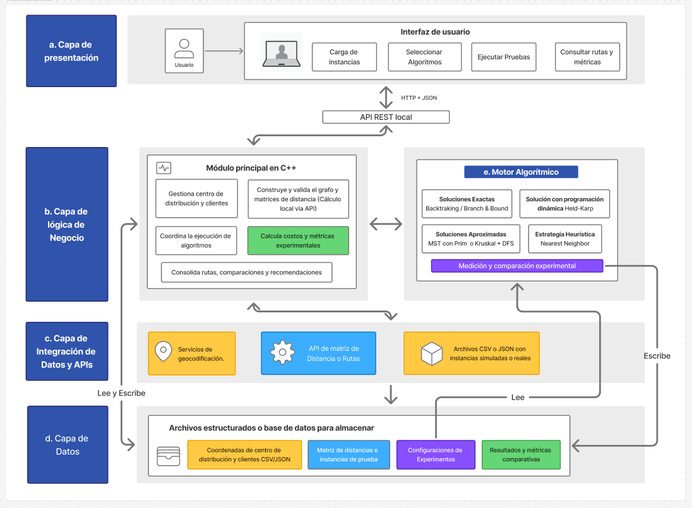

# RouteOpt

Sistema para comparar estrategias algorítmicas que resuelven rutas de distribución
desde un centro logístico hacia múltiples clientes (variante del problema del viajante, TSP):
algoritmos exactos, aproximados y heurísticos.

Curso: Análisis y Diseño de Algoritmos · USIL · Profesor: Castañeda Alban, Jorge Eduardo · 2026-II

**Pregunta del proyecto:** ¿cómo seleccionar y aplicar una estrategia algorítmica para obtener
rutas de alta calidad, considerando el crecimiento del número de destinos, el costo
computacional y la diferencia entre soluciones exactas, aproximadas y heurísticas?

## 1. Estado del proyecto

| Componente | Estado |
|---|---|
| Motor C++: carga y validación de instancias, generador con semilla, Haversine | Hecho |
| Algoritmos: Nearest Neighbor, MST + DFS (Prim), Held-Karp, Backtracking con poda | Hecho y verificado (`routeopt-tests`) |
| Medición de tiempo, memoria y operaciones | Hecho |
| Servidor Node: `health`, `generate`, `solve`, `compare` (con cálculo del gap) | Hecho |
| Web React: mapa, generar instancia, comparar algoritmos, tabla de resultados | Hecho |
| Script de benchmark y de tablas | Hecho |
| API externa de distancias por calles (con caché) | Pendiente |
| Importador CSV/JSON y geocodificación | Pendiente |
| Recomendación adaptativa según el tamaño | Pendiente |
| Exportación desde la web y gráficos | Pendiente |

## 2. Arquitectura y carpetas

Los bloques a–e son los de la propuesta del profesor. El detalle de los mensajes entre las
piezas está en [`docs/contratos.md`](docs/contratos.md).

| Carpeta | Bloque | Contenido |
|---|---|---|
| `web/` | a) Presentación | React + Vite + Leaflet |
| `server/` | API REST local | Node + Express: lanza el motor, calcula el gap, scripts de benchmark |
| `engine/` | b) Lógica de negocio y e) Motor algorítmico | C++17: instancias, grafo, algoritmos, métricas, pruebas |
| `data/` | d) Capa de datos | Instancias, caché de matrices, resultados de experimentos |
| `docs/` | | Contratos entre las piezas |

Flujo: React → servidor Node (`127.0.0.1:3001`) → ejecutable `routeopt-engine`
(recibe JSON por la entrada estándar y responde JSON por la salida estándar; un proceso
por ejecución).


*Figura 1. Arquitectura lógica de RouteOpt. El diagrama muestra el diseño completo del sistema; los componentes que aún no están implementados figuran en la tabla de la sección 1.*


*Figura 2. Vista de la demo. Lo primero que se ve es la instancia donde se define la cantidad de nodos y la semilla. Posteriormente estan listados los algoritmos.*

### 2.1 Conceptos clave: N y semilla

**N (tamaño de la instancia).** Es el número total de nodos, **incluyendo el depósito**.
El nodo 0 es siempre el centro de distribución y los nodos 1..N−1 son los clientes. En la
web se llama "Nodos (con depósito)" y en la API, `n`.

- N = 10 significa 1 depósito + 9 clientes.
- Una ruta parte del depósito, visita cada cliente exactamente una vez y regresa. Hay
  (N−1)! rutas posibles, y por eso el problema se vuelve inviable de resolver por fuerza
  bruta:

| N | Clientes | Rutas posibles (N−1)! |
|---|---|---|
| 5 | 4 | 24 |
| 10 | 9 | 362 880 |
| 15 | 14 | ≈ 8,7 × 10¹⁰ |
| 20 | 19 | ≈ 1,2 × 10¹⁷ |
| 50 | 49 | ≈ 6,1 × 10⁶² |

- Cada algoritmo tiene un tamaño máximo (sección 5). El generador acepta de 2 a 5000
  nodos y la web, de 2 a 2000.

**Semilla (`seed`).** Es un número entero que inicia el generador de números pseudoaleatorios
con el que se ubican los clientes dentro del área de Lima. Es lo que hace que las
instancias sean **reproducibles**.

- Misma N + misma semilla + misma área → **exactamente la misma instancia**, en cualquier
  computadora. La instancia se identifica con un nombre, por ejemplo `gen-n10-seed42`.
- Distinta semilla → otra instancia (otras coordenadas). Sirve para tener variedad: el
  benchmark usa las semillas 1 a 10 en cada tamaño.
- Con la misma semilla, la instancia de N+1 nodos es la de N nodos más un cliente nuevo.
  Por eso, al mantener la semilla y subir N, la dificultad puede cambiar de forma
  irregular (un cliente nuevo puede facilitar o dificultar la poda del backtracking).
- Los algoritmos son deterministas: el mismo algoritmo sobre la misma instancia devuelve
  siempre la misma ruta. Lo único que varía entre ejecuciones es el tiempo (y un poco la
  memoria).
- Para comparar algoritmos hay que usar **la misma instancia** (mismo N y misma semilla);
  si cada uno resolviera una instancia distinta, la comparación no valdría.
- Si una demostración o un resultado interesante sale con una semilla al azar, se anota la
  semilla para poder repetirlo.

## 3. Requisitos (Ubuntu)

```bash
sudo apt update
sudo apt install -y build-essential cmake git curl jq
```

- `g++` con soporte de C++17 y `cmake` 3.16 o superior.
- Node.js (se desarrolló con la v26; instalación recomendada con `nvm`) y `npm`.
- `jq` solo se usa para las pruebas manuales con `curl`.
- La biblioteca de JSON del motor (`nlohmann/json`) ya viene dentro del repositorio.
- La medición de memoria lee `/proc`, así que solo funciona en Linux.

## 4. Instalación y arranque

### 4.1 Motor (C++)

```bash
cd engine
cmake -S . -B build -DCMAKE_BUILD_TYPE=Release
cmake --build build -j
./build/routeopt-tests
```

Debe terminar con `0 fallos`. Siempre compilar en modo Release: sin optimización los
tiempos no son comparables.

Prueba rápida del motor:

```bash
echo '{"mode":"ping"}' | ./build/routeopt-engine
echo '{"mode":"generate","n":5,"seed":42}' | ./build/routeopt-engine
```

### 4.2 Servidor (Node)

```bash
cd server
npm install
npm test        # pruebas del cálculo del gap
npm start       # queda corriendo en http://127.0.0.1:3001
```

Comprobación (en otra terminal): `curl -s localhost:3001/api/health | jq`

### 4.3 Web (React)

Con el servidor corriendo, en otra terminal:

```bash
cd web
npm install
npm run dev     # abrir http://localhost:5173
```

El mapa necesita internet para cargar las imágenes de fondo.

## 5. Algoritmos

`N` es el número total de nodos, incluyendo el depósito (nodo 0).

| Algoritmo | Tipo | Complejidad | Tamaño máximo | Qué cuenta `operations` |
|---|---|---|---|---|
| Nearest Neighbor | Heurística voraz | O(N²) | 5000 | Comparaciones de distancias |
| MST + DFS (Prim) | Aproximado | O(N²) | 5000 | Aristas evaluadas, N(N−1)/2 |
| Held-Karp | Exacto, programación dinámica | Tiempo O(N²·2ᴺ), memoria O(N·2ᴺ) | 20 | Transiciones de la tabla |
| Backtracking (branch and bound) | Exacto, con poda | Peor caso factorial | 100 | Nodos del árbol explorados |

- **MST + DFS** es una 2-aproximación solo si la matriz es simétrica y cumple la desigualdad
  triangular.
- **Backtracking** parte de la solución de Nearest Neighbor como cota inicial y poda una
  rama cuando el costo parcial más la suma de la arista de salida más barata de cada nodo
  pendiente iguala o supera la mejor ruta conocida. Su límite práctico lo pone el tiempo.
- **Held-Karp** usa máscaras de bits. Su límite lo pone la memoria (unos 90 MB con N=20).
- La ruta empieza en el nodo 0 y el costo incluye el regreso al depósito.

## 6. Benchmark (para el informe)

### Qué evalúa el benchmark

El benchmark resuelve **las mismas instancias** con los cuatro algoritmos y mide qué tan
bien y a qué costo lo hace cada uno al crecer N. Responde estas preguntas:

1. **¿Hasta qué tamaño es viable cada algoritmo exacto?** Backtracking: a partir de qué N
   agota el tiempo límite. Held-Karp: se detiene en N=20 por la memoria (O(N·2ᴺ)).
2. **¿Cuánta calidad se pierde con los algoritmos rápidos?** Es el gap de Nearest Neighbor
   y de MST + DFS respecto a la mejor ruta.
3. **¿Cómo crecen el tiempo, las operaciones y la memoria con N?** Se contrasta con la
   complejidad teórica.
4. **¿Nearest Neighbor o MST + DFS?** Qué tan rápido es cada uno y cuál da la ruta más
   corta, instancia por instancia.
5. **¿Qué estrategia conviene según N?** Los resultados sirven de base para los umbrales de
   la recomendación adaptativa (pendiente).

**Qué se mide en cada instancia y algoritmo:**

| Métrica | Qué es |
|---|---|
| Estado | `ok` (terminó), `timeout` (agotó el tiempo límite) o `skipped` (no admite ese tamaño) |
| Costo (km) | Longitud de la ruta, incluyendo el regreso al depósito |
| Gap (%) | Qué tan lejos queda de la referencia; ver "Cómo leer los gaps" más abajo |
| Tiempo (ms) | Solo la ejecución del algoritmo, con reloj monótono de C++ (sin contar el JSON ni el arranque del proceso) |
| Operaciones | Unidad de trabajo propia de cada algoritmo (tabla de la sección 5) |
| Memoria extra (KB) | Pico de memoria menos la memoria base antes de ejecutar el algoritmo |

**Diseño del experimento:** N = 5, 10 a 18, 20 y 50; 10 semillas por tamaño (1 a 10); límite
de 10 s por algoritmo. Los resultados se resumen con la mediana (costo, tiempo, operaciones
y memoria) y con el promedio y el máximo (gap). Si la primera ejecución dura menos de
500 ms, se repite hasta 5 veces y se guarda la mediana del tiempo; las repeticiones además
verifican que el algoritmo devuelva siempre el mismo costo.

**Qué NO evalúa:**

- La **corrección** de los algoritmos. Eso lo verifica `routeopt-tests` (por ejemplo,
  Held-Karp y backtracking contra fuerza bruta para N ≤ 9). El benchmark mide rendimiento y
  calidad, no demuestra que el código sea correcto.
- Distancias reales por calles, ni la operación de una empresa real: las instancias son
  aleatorias sobre un rectángulo de Lima con distancias Haversine.
- Restricciones adicionales (varios vehículos, ventanas de tiempo, capacidad).

Reglas para que los datos sean válidos:

1. **Una sola persona corre la corrida oficial, en un solo equipo.** Los tiempos de equipos
   distintos no se pueden comparar. El archivo `.meta.json` registra el equipo usado.
2. Cerrar el servidor (`npm start`), el navegador y cualquier programa pesado. Conectar el
   equipo a la corriente y no usarlo mientras corre.
3. No ejecutar nada más en paralelo.

```bash
cd server

# Prueba corta (borrar su resultado después)
node scripts/benchmark.js --sizes=5,10 --seeds=2 --reps=3
node scripts/summarize.js
rm ../data/results/benchmark-*

# Corrida completa: N = 5, 10 a 18, 20 y 50; 10 semillas; límite de 10 s por algoritmo
node scripts/benchmark.js
node scripts/summarize.js
```

La corrida completa toma unos 6 a 10 minutos (estimación: depende del equipo y de lo que
tarde el backtracking en N=17 y 18). Lo que más pesa son los tiempos agotados en N=20 y 50.

Opciones: `--sizes=5,10,15`, `--seeds=10`, `--reps=5`, `--limit=10000` (milisegundos) y
`--out=ruta.csv`. Cada instancia se repite hasta 5 veces solo si la primera ejecución dura
menos de 500 ms; se guarda la mediana.

Salidas en `data/results/`:

- `benchmark-FECHA.csv`: una fila por instancia y algoritmo (costo, gap, tiempo mediano,
  mínimo y máximo, repeticiones, operaciones, memoria extra).
- `benchmark-FECHA.csv.meta.json`: equipo, versiones y parámetros del experimento.
- `benchmark-FECHA-tablas.md`: las tablas del informe (comparación por tamaño y algoritmo,
  viabilidad del backtracking, Nearest Neighbor frente a MST + DFS).

Los resultados **sí** se suben al repositorio: son la evidencia del informe.

**Cómo leer los gaps:**

- `gap = (costo − referencia) / referencia × 100`.
- Si terminó un algoritmo exacto (Held-Karp o backtracking), la referencia es el **óptimo**.
- Si no (N=50, por ejemplo), la referencia es la **mejor solución conocida** entre los
  algoritmos que terminaron, y el gap **no** es respecto al óptimo. El informe debe decirlo.
- "Viable" depende del límite de tiempo: indicar siempre con qué límite se midió.
- La memoria extra (pico menos memoria base) solo es significativa para Held-Karp; en los
  demás es ruido del sistema.

**Reproducibilidad:** con la misma `n`, la misma semilla y la misma área, el generador produce
siempre la misma instancia (`gen-n10-seed42`). Lo único que varía entre corridas son los tiempos.

## 7. API REST (resumen)

Detalle completo, con formatos y códigos de error, en [`docs/contratos.md`](docs/contratos.md).

| Ruta | Qué hace |
|---|---|
| `GET /api/health` | Comprueba el servidor y el motor |
| `POST /api/instances/generate` | Genera una instancia (`n`, `seed`) |
| `POST /api/solve` | Resuelve con un algoritmo |
| `POST /api/compare` | Ejecuta varios algoritmos en serie y calcula el gap |

Las ejecuciones del motor se atienden una a la vez para no contaminar los tiempos.

## 8. Supuestos y limitaciones

- Un solo vehículo, sin ventanas de tiempo, capacidad suficiente (TSP simétrico).
- Hoy las distancias son Haversine (línea recta sobre la esfera): simétricas y con
  desigualdad triangular por construcción. El código valida que la matriz sea n×n, con
  diagonal 0, pesos finitos y no negativos, y simétrica; **no** comprueba la desigualdad
  triangular, y en matrices que vengan de archivo se asume.
- Las instancias de los experimentos son aleatorias uniformes sobre un rectángulo de Lima:
  sirven para comparar algoritmos, no para afirmar nada sobre la operación de una empresa real.
- Las líneas del mapa son rectas porque las distancias son Haversine.

## 9. Problemas frecuentes

| Síntoma | Causa y solución |
|---|---|
| `npm start` dice que no encuentra `package.json` | Estás en otra carpeta. Verificar con `pwd`: servidor en `server/`, web en `web/` |
| "No existe el motor en ..." | Falta compilar: `cmake --build build -j` dentro de `engine/` |
| La web dice "No se pudo conectar con el servidor" | El servidor no está corriendo: `npm start` dentro de `server/` |
| `curl` falla con "La lista de argumentos es demasiado larga" | Una instancia grande no cabe en `-d "..."`. Enviar el cuerpo por la entrada estándar con `--data-binary @-` |
| Las pruebas del motor dan `FALLO` | No usar los números de ese equipo; avisar con la línea del fallo |

## 10. Licencia

MIT (ver `LICENSE`).
